# Plateforme de gestion des ressources humaines — Commune Urbaine de Meknès


Application web full-stack qui informatise le circuit RH d'une collectivité territoriale : dossiers du personnel, demandes de congé, ordres de mission, attestations et pilotage par tableau de bord.

**Contexte.** Projet réalisé pendant mon stage d'initiation (1ʳᵉ année du cycle ingénieur, ENSA Fès) au sein de la Division des Ressources Humaines de la Commune Urbaine de Meknès.

## Maquettes d'interface

Les images ci-dessous sont les **maquettes de conception** de l'interface (données fictives). Elles servent de référence visuelle au développement.

| | |
|---|---|
| 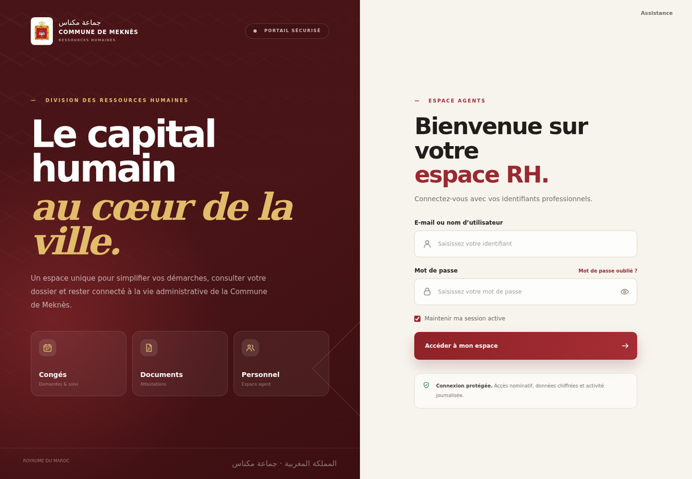<br>**Connexion** | 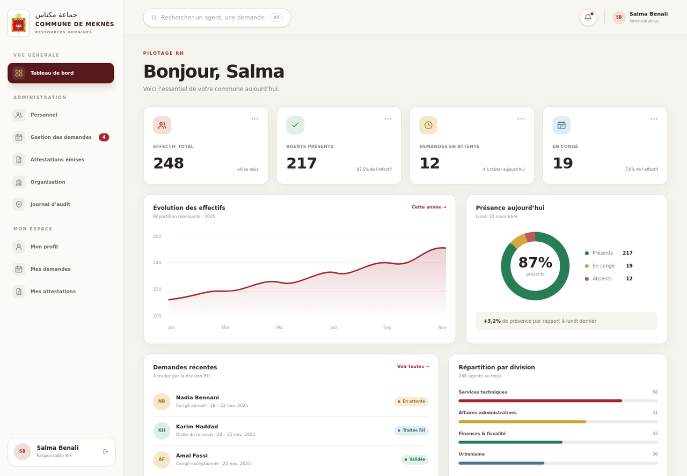<br>**Tableau de bord** |
| 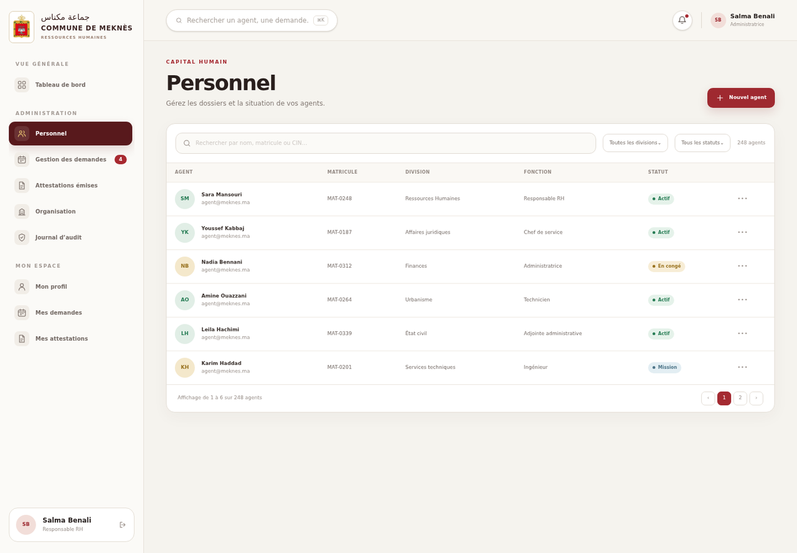<br>**Personnel** | 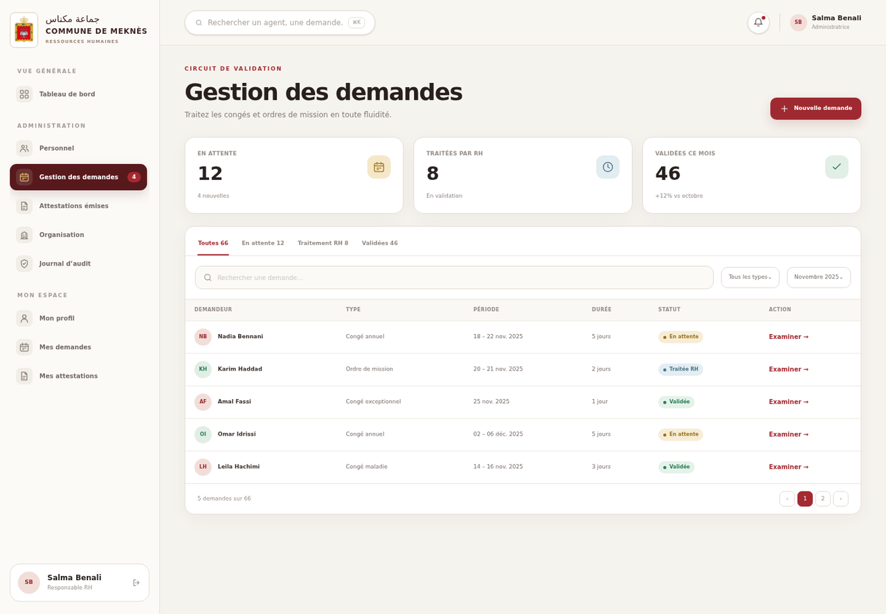<br>**Gestion des demandes** |
| 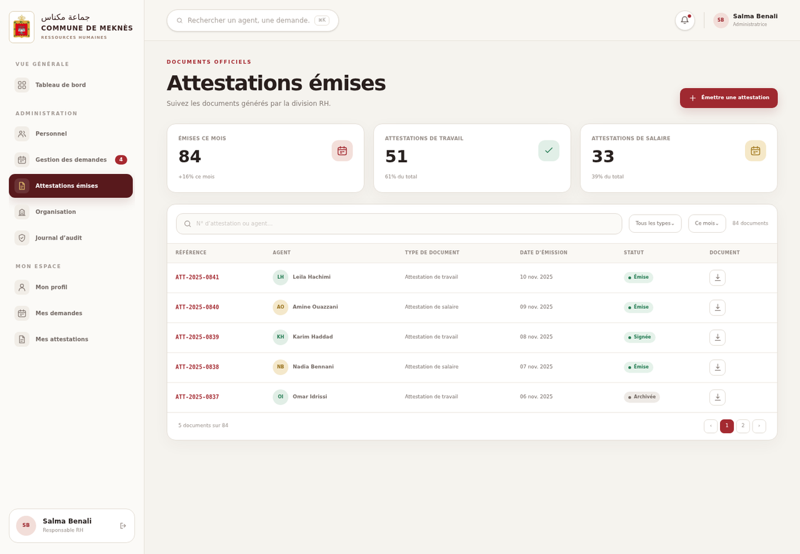<br>**Attestations émises** | 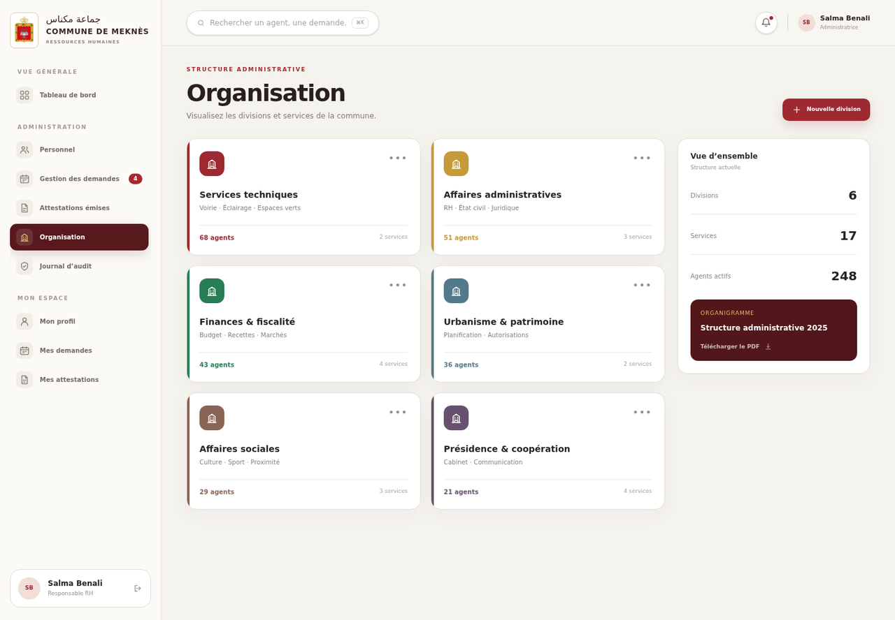<br>**Organisation** |
| 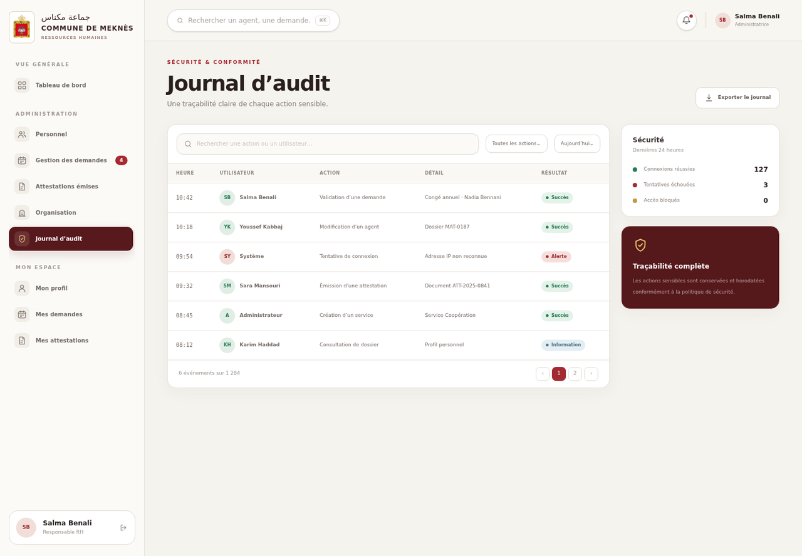<br>**Journal d'audit** | 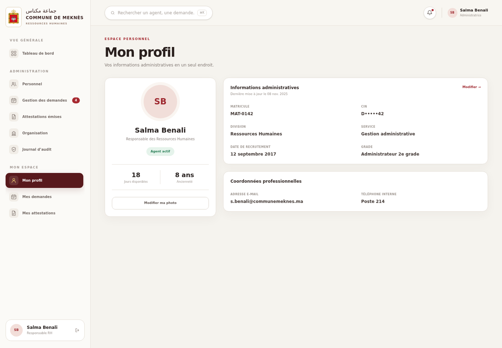<br>**Mon profil** |
| 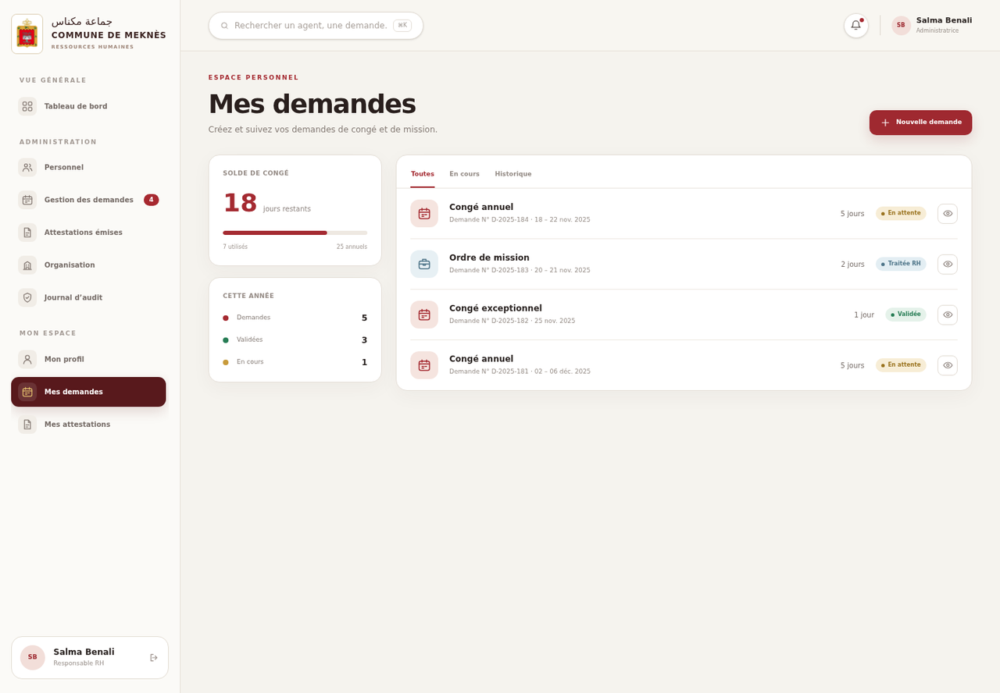<br>**Mes demandes** | 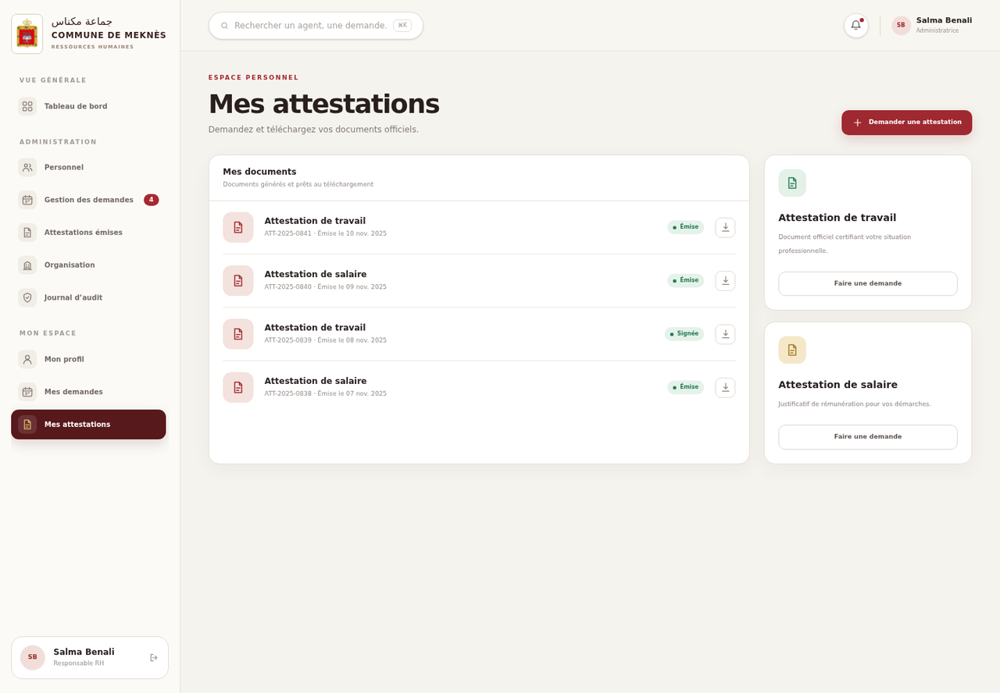<br>**Mes attestations** |

## Fonctionnalités

- **Authentification** par jeton JWT et contrôle d'accès par profil : administrateur, responsable RH, chef hiérarchique, agent.
- **Personnel** : création, modification, désactivation et réactivation d'un agent, fiche détaillée, recherche et filtres par division et par statut.
- **Congés** : calcul automatique des jours ouvrables (week-ends et jours fériés exclus), contrôle du solde et des chevauchements de périodes, bulletin de congé imprimable.
- **Ordres de mission** et **attestations** de travail et de salaire imprimables.
- **Circuit de validation** : agent → traitement par le service RH → décision de l'administrateur. Le solde est déduit à la demande et restitué en cas de refus ou de suppression.
- **Organisation** : divisions et services, export imprimable de l'organigramme.
- **Tableau de bord** : effectifs, présence du jour, évolution des congés sur 12 mois, calendrier des absences, alertes.
- **Journal d'audit** : toute action modifiante est tracée ; consultation et export CSV par l'administrateur.

## Rôles

| Rôle | Principales actions |
|---|---|
| Agent | Consulter son profil, déposer et suivre ses demandes, demander une attestation |
| Chef hiérarchique | Mêmes droits que l'agent |
| Responsable RH | Gérer le personnel, traiter les demandes, imprimer bulletins et attestations |
| Administrateur | Tous les droits : organisation, validation finale, journal d'audit |

## Architecture

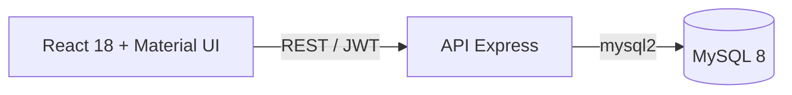

| Couche | Technologies |
|---|---|
| Interface | React, Material UI, Vite |
| API | Node.js, Express, JWT, bcrypt, helmet, express-rate-limit |
| Données | MySQL 8 — schéma dans `database/schema.sql`, créé au premier démarrage |

Le détail (modèle de données, circuit de validation, choix techniques) est dans [`docs/ARCHITECTURE.md`](docs/ARCHITECTURE.md).


## Structure du projet

```
rh-commune-meknes/
├── backend/            API REST (server.js, lib/dates.js, test/)
├── frontend/           Interface React (src/App.jsx, public/logo.png)
├── database/           schema.sql
├── docs/               ARCHITECTURE.md, maquettes d'interface
├── docker-compose.yml
└── run.bat / run.sh    Lancement local
```


## Sécurité

Mots de passe hachés (bcrypt), jetons JWT à durée limitée, contrôle d'accès par rôle côté serveur, requêtes SQL paramétrées, en-têtes `helmet`, limitation des tentatives de connexion, journal d'audit.


## Limites connues et pistes d'évolution

- Découper `frontend/src/App.jsx` en composants et en pages distincts.
- Ajouter des tests d'intégration de l'API et des tests de l'interface.
- Conserver un historique des effectifs pour tracer leur évolution dans le temps.
- Notifications par e-mail et gestion de la photo de profil.


## Auteure

**Karima Hajjioui** — élève ingénieure en Génie Informatique, ENSA Fès
[LinkedIn](https://www.linkedin.com/in/karima-hajjioui-b8a34a32a)
