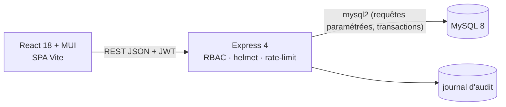
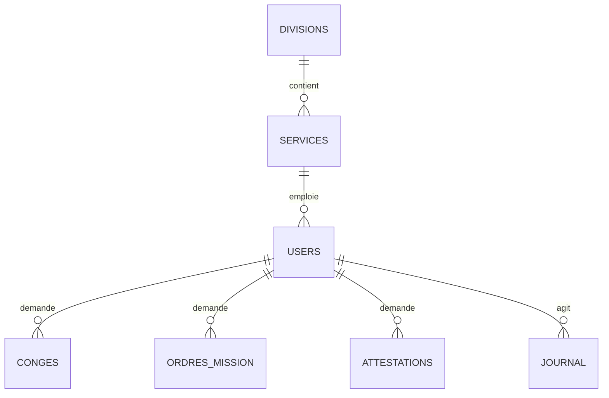
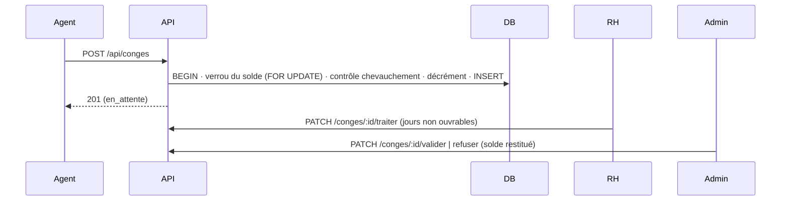

# Architecture technique

## Vue d'ensemble

## Modèle de données (extrait)

## Circuit de validation d'un congé

## Choix d'ingénierie
- **Transactions + verrou de ligne** : deux demandes simultanées ne peuvent pas dépasser le solde.
- **Calcul des jours ouvrables en UTC**, testé unitairement (`backend/test`).
- **RBAC côté serveur** (admin / rh / chef / agent) : l'interface n'est jamais la seule barrière.
- **Journal d'audit transversal** : toute requête modifiante est tracée (middleware), consultable par l'admin.
- **Statistiques agrégées en SQL** (tendance mensuelle, parité, alertes) plutôt qu'en JavaScript.
- **Visualisations en SVG natif** (courbe lissée par Bézier, jauge, anneaux, constellation) : zéro dépendance de graphiques.
- **Déploiement reproductible** : Docker Compose, CI GitHub Actions.
